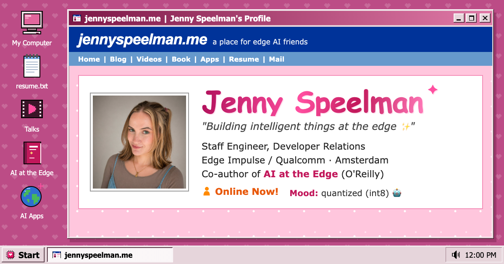
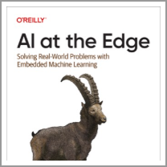

<!-- Jenny 98 edition: matches the site at https://jennyplunkett.me -->

### ✦ Jenny's Blurbs

**About me:** I'm a Staff Engineer in Developer Relations at [Edge Impulse](https://edgeimpulse.com/) (now part of Qualcomm), based in Amsterdam. For over five years I've helped developers, researchers, and companies take machine learning from the cloud to the constraint: tiny sensors, microcontrollers, and the devices that actually touch the physical world. I co-wrote [*AI at the Edge*](https://www.oreilly.com/library/view/ai-at-the/9781098120191/) for O'Reilly, and these days I also [build apps with AI](https://www.jennyspeelman.dev/).

**Mood:** quantized (int8) 🤖 &nbsp;·&nbsp; 🟠 **Online Now!**

### 💌 Contacting Jenny

[🌐 jennyspeelman.me](https://jennyspeelman.me/) &nbsp;·&nbsp; [➕ Add to Friends](https://www.linkedin.com/in/jennyplunkett) &nbsp;·&nbsp; [💬 Instant Message](https://mastodon.world/@jennyp) &nbsp;·&nbsp; [📧 Send Message](mailto:hello@jennyplunkett.me) &nbsp;·&nbsp; [📄 resume.txt](https://jennyplunkett.me/#resume)

### ★ Jenny's Top 8

<table>
  <tr>
    <td align="center" width="25%"><a href="https://www.oreilly.com/library/view/ai-at-the/9781098120191/"> <b>AI at the Edge</b></a></td>
    <td align="center" width="25%"><a href="https://arxiv.org/abs/2212.03332"> <b>MLOps Paper</b></a></td>
    <td align="center" width="25%"><a href="https://apps.apple.com/us/app/fanficly-ao3-fanfiction/id6775897153"> <b>Fanficly</b></a></td>
    <td align="center" width="25%"><a href="https://differentialis.app"> <b>Differentialis</b></a></td>
  </tr>
  <tr>
    <td align="center" width="25%"><a href="https://synthetic.jennyspeelman.dev"> <b>Synthetic Data Studio</b></a></td>
    <td align="center" width="25%"><a href="https://github.com/yennster/party-house"> <b>Party House</b></a></td>
    <td align="center" width="25%"><a href="https://label.jennyspeelman.dev"> <b>EI Label Studio</b></a></td>
    <td align="center" width="25%"><a href="https://www.jennyspeelman.dev/"> <b>jennyspeelman.dev</b></a></td>
  </tr>
</table>

### 📝 Jenny's Latest Blog Entries

- [PatchCore Boosts Visual Anomaly Detection in Edge Impulse](https://www.edgeimpulse.com/blog/patchcore-boosts-visual-anomaly-detection-in-edge-impulse/) · Oct 2024
- [Unlock Greater Data Flexibility: Ingest Tabular Data](https://www.edgeimpulse.com/blog/unlock-greater-data-flexibility-ingest-tabular-data/) · Sep 2024
- [How to Use USD Assets for Any Edge AI Use Case with NVIDIA Omniverse](https://www.edgeimpulse.com/blog/how-to-use-usd-assets-for-any-edge-ai-use-case-with-nvidia-omniverse/) · Aug 2024
- [Impulse Experiments: Revolutionize Your AI Project Workflow](https://edgeimpulse.com/blog/impulse-experiments-revolutionize-your-ai-project-workflow/) · Jul 2024
- [How to Train an Object Detection Model for Visual Inspection with Synthetic Data](https://developer.nvidia.com/blog/how-to-train-an-object-detection-model-for-visual-inspection-with-synthetic-data/) (NVIDIA) · May 2024

[View all 40 blogs, docs & research →](https://jennyplunkett.me/#writing)

### 📼 Now Playing

▶️ **[Edge AI Tooling & Development Frameworks: MLOps for Edge AI](https://www.edgeaifoundation.org/events/30688)** · Edge AI Foundation Taipei 2025 · Nov 2025

[View all 58 webinars, talks & interviews →](https://jennyplunkett.me/#talks)

### 💾 Jenny's Interests

**General:** Edge AI, TinyML, embedded ML, sensors & dev boards, synthetic data, apps built with AI, making hard things approachable

---

  
  
  
  
  

Boot the full desktop at <a href="https://jennyspeelman.me/">jennyspeelman.me</a> ✦ prefer it calm? <a href="https://jennyplunkett.me/#plainview">plain view</a>

